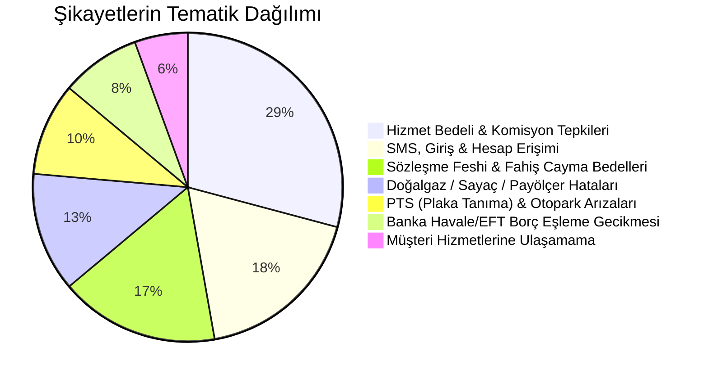
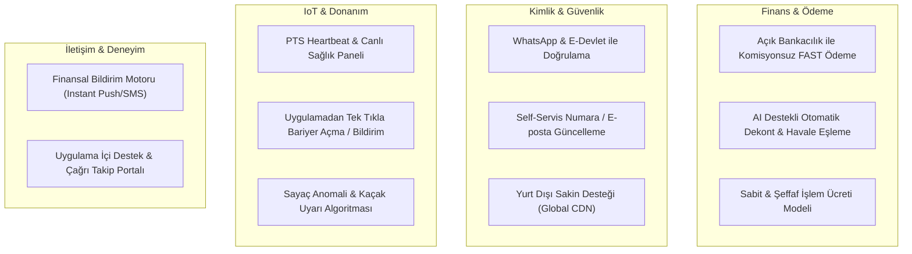

# Apsiyon Şikayet Analizi ve Ürün Geliştirme Yol Haritası (Product Roadmap)

Bu rapor, [Şikayetvar - Apsiyon](https://www.sikayetvar.com/apsiyon) sayfasından kazınan **144 şikayet verisinin** metin madenciliği ve kök neden analiziyle incelenmesi sonucunda hazırlanmıştır. 

Apsiyon platformunun müşteri kaybını önlemek, Şikayetvar puanını yükseltmek ve kullanıcı memnuniyetini maksimize etmek için **düzeltmesi gereken hatalar**, **yeniden tasarlaması gereken iş mantıkları** ve **geliştirmesi gereken yeni özellikler** 4 ana modülde toplanmıştır.

---

## 1. Yönetici Özeti ve Şikayet Dağılımı

144 şikayet incelendiğinde en çok tepki çeken ve kullanıcıları mağdur eden alanlar şu şekildedir:

---

## 2. Hata Veren ve Yanlış Çalışan Kısımlar (Bugs & Failures)

### 2.1. SMS Doğrulama ve Hesap Kilitlenmesi (Critical Auth Bug)
- **Sorun:** Kullanıcılar telefon numarası değiştirmek istediğinde doğrulama SMS'i eski numaraya gitmeye devam ediyor veya yeni numaraya hiç ulaşmıyor.
- **Sonuç:** Kullanıcı dairesine ait borçları göremiyor, aidatını ödeyemiyor ve temerrüde düşerek haksız gecikme faizi ödüyor.
- **Kök Neden:** Kimlik doğrulama servisinin (Auth service) GSM sağlayıcıları ile entegrasyonunda failover (yedekli gateway) olmaması ve telefon güncelleme akışında eski session/cache'in düşmemesi.

### 2.2. Banka Havale/EFT Mutabakat Gecikmesi ve Haksız Faiz (Reconciliation Bug)
- **Sorun:** Kat sakini aidatını veya yakıt bedelini bankadan EFT/Havale ile günü gününe ödüyor; ancak Apsiyon sisteminde borç 3 ila 30 gün boyunca silinmiyor ve sistem otomatik gecikme faizi işletmeye devam ediyor.
- **Sonuç:** Sakinler icra tehdidi ve yönetimle gerginlik yaşıyor ("Ödediğim paranın faizini ödüyorum").
- **Kök Neden:** Banka hareketlerinin (MT940/API) Apsiyon muhasebe modülüne otomatik yansımaması, işlem açıklamalarının regex ile parse edilememesi ve yönetici manuel onayına bağımlı kalması.

### 2.3. Plaka Tanıma Sistemi (PTS) Donanım/Yazılım Senkronizasyon Kaybı
- **Sorun:** Güncelleme sonrasında veya keyfi olarak yıllardır aynı sitede oturan araç sahiplerinin plakaları aniden okunmamaya başlıyor; bariyer açılmıyor, kapıda 15-20 dakikalık kuyruklar oluşuyor.
- **Sonuç:** Site sakinleri site yönetimini, site yönetimi de Apsiyon'u suçluyor; donanım kiralama bedeli ödendiği halde hizmet alınamıyor.
- **Kök Neden:** PTS uç birimlerindeki (Edge/Kamera) lokal veritabanı ile Apsiyon bulut veritabanı arasındaki veri senkronizasyonunun kopması ve çevrimdışı (offline) toleransının olmaması.

### 2.4. Isınma / Payölçer Hatalı Formül ve Çarpan Problemleri
- **Sorun:** Merkezi sistem ısı payölçer okumalarında hatalı katsayı veya endeks kullanımı nedeniyle dairelere 4.000 TL – 7.000 TL gibi absürt faturalar çıkarılıyor.
- **Sonuç:** Sitede kaos ortamı oluşuyor, itirazlar incelenene kadar fatura faiz işletiyor.

---

## 3. Yanlış Kurgulanan İş Mantıkları ve Kullanıcı Tepkileri

### 3.1. Orantısız ve Değişken "Hizmet Bedeli" (Komisyon) Politikası
- **Kullanıcı Tepkisi:** *"Zaten 10.000 TL aidat ödüyorum, Apsiyon kartla ödeme yaparken benden ekstra %5-7 (150-330 TL) hizmet bedeli kesiyor. Yazılımın 1.000 TL ile 10.000 TL işleminde yaptığı iş aynı değil mi?"*
- **Algı:** Kullanıcılar Apsiyon'u aracı tefeci gibi algılamaya başlıyor. Hizmet bedelinin ödeme ekranında şeffaf olarak önceden ayrıştırılmaması öfkeyi katlıyor.

### 3.2. Habersiz Geriye Dönük Borçlandırma
- **Kullanıcı Tepkisi:** Kat sakinlerine hiçbir push bildirim veya SMS gönderilmeden geriye dönük ek bütçe veya aidat zammı yansıtılıyor; kullanıcı uygulamaya girdiğinde "gecikmiş borç" ile karşılaşıyor.

### 3.3. Fahiş Cayma Bedelleri ve Fesih Zorluğu
- **Yönetici Tepkisi:** Bir yıl içinde 3 defa zam yapılmasına rağmen ayrılmak isteyen site yönetimlerine 36 aylık cayma bedeli çıkarılıyor; telefonla iptal talebi alınmasına rağmen aylar sonra fatura kesilmeye devam ediliyor.

---

## 4. Geliştirilmesi Gereken Özellikler (Feature Recommendations)

### 1. Finans & Ödeme Modülü İyileştirmeleri

#### Özellik 1: Açık Bankacılık (Open Banking) FAST ile Anında Komisyonsuz Ödeme
- **Nasıl Çalışacak:** Kat sakini kart komisyonu ödemek istemediğinde, Apsiyon ekranından kendi bankasını seçerek FAST/Kolay Adres protokolüyle **sıfır komisyonla** ödeme yapabilecek.
- **Fayda:** Kullanıcının kart komisyonu öfkesi tamamen ortadan kalkar; para anında site hesabına geçer.

#### Özellik 2: AI / OCR Destekli Otomatik Havale & Dekont Eşleme Motoru
- **Nasıl Çalışacak:** Sakin bankadan EFT yaparken açıklama kısmına otomatik daire kodu yazar veya mobil uygulamaya dekontun fotoğrafını yükler. OCR motoru saniyeler içinde tutarı, IBAN'ı ve tarihi eşleyerek borcu anında sıfırlar ve faiz işletimini durdurur.
- **Fayda:** Günlerce süren "Borcum silinmedi" şikayetleri %100 biter.

#### Özellik 3: Şeffaf Fiyatlandırma ve Tavan Komisyon Sınırı
- **Nasıl Çalışacak:** Yüzdelik fahiş komisyon yerine, banka takas maliyetini aşmayan makul ve tavan sınırı (Cap) olan bir işlem ücreti kurgulanmalı. Ödeme ekranında `Aidat: 3.000 TL | Banka İşlem Ücreti: 19 TL` şeklinde şeffaf döküm verilmeli.

---

### 2. Kimlik Doğrulama & Hesap Yönetimi (Auth & Profile)

#### Özellik 4: Çok Kanallı Doğrulama (Multi-Channel Auth Fallback)
- **Nasıl Çalışacak:** SMS gitmediğinde sistem 45 saniye sonra otomatik olarak **WhatsApp Doğrulama Kodu** veya **E-posta Doğrulama Linki** sunmalı.
- **Fayda:** SMS operatör kaynaklı erişim krizleri sıfıra iner.

#### Özellik 5: Self-Servis Numara Güncelleme ve Daire İçi Rol Yönetimi
- **Nasıl Çalışacak:** Eski telefonuna erişemeyen kullanıcılar için; daire yöneticisinin onay vermesiyle veya e-Devlet kapısı doğrulamasıyla tek tıkla yeni numara tanımlanabilmeli. "TC kayıtlı / numara zaten var" deadlock durumu çözülmeli.

#### Özellik 6: Yurt Dışı Sakin Erişimi (Global CDN & Uluslararası Gateway)
- **Nasıl Çalışacak:** Lüksemburg, Almanya gibi ülkelerde yaşayan mülk sahipleri için Cloudflare/AWS CloudFront kuralları esnetilmeli, `ERR_CONNECTION_TIMED_OUT` hataları giderilmeli ve uluslararası ülke kodlarına (+352, +49) sorunsuz SMS routing yapılmalı.

---

### 3. IoT, Donanım & Saha Operasyonları (PTS & Sayaç)

#### Özellik 7: PTS Otomatik Teşhis (Heartbeat & Health Dashboard)
- **Nasıl Çalışacak:** Otoparktaki kamera veya kontrol ünitesi her 60 saniyede bir merkeze sinyal (heartbeat) göndermeli. Bağlantı koptuğunda hem site yönetimine hem Apsiyon teknik saha ekibine anında push bildirim düşmeli.
- **Fayda:** 3 ay boyunca arızalı kalan ve fark edilmeyen PTS skandalları engellenir.

#### Özellik 8: Mobil Uygulamadan "Bariyer Açılmadı / Geçici İzin" Butonu
- **Nasıl Çalışacak:** Kamera plakayı okumadığında, sakin uygulamadan tek tuşla GPS konumu teyidiyle bariyeri tetikleyebilmeli veya güvenlik kulübesine anlık "Kayıtlı Plaka Teyidi" uyarısı gönderebilmeli.

#### Özellik 9: Isı Payölçer & Sayaç Anomali Algılama Algoritması
- **Nasıl Çalışacak:** Bir dairenin yakıt/su faturası, bloğun veya sitenin medyan tüketim değerinin 3 katını aştığında sistem faturayı yöneticiye onaylatmadan yayınlamamalı; "Anomali Uyarısı: 12 No'lu dairede beklenmedik yüksek tüketim tespit edildi, sayacı kontrol edin" uyarısı vermelidir.

---

### 4. İletişim, Hukuk ve Şeffaflık Sistemi

#### Özellik 10: Finansal Olay Bildirim Motoru (Event-Driven Notifications)
- **Nasıl Çalışacak:** Daireye eklenen her yeni borç, ek bütçe kararı veya gecikme uyarısında eş zamanlı olarak Push Bildirim + E-posta gönderilmeli. Sakinin uygulamayı açmadığı durumlarda "haberim yoktu" mağduriyeti önlenmeli.

#### Özellik 11: Site Yönetimleri İçin Şeffaf Sözleşme & İptal Portalı
- **Nasıl Çalışacak:** Yönetici panelinde sözleşmenin başlangıç-bitiş tarihleri, taahhüt koşulları, fesih bildirim süresi ve cayma bedeli hesaplama sihirbazı açıkça yer almalı. Keyfi fiyat artışları sözleşme şartlarına bağlanarak güven tazelenmeli.

---

## 5. Uygulama Önceliklendirme Matrisi (Impact vs. Effort)

| Öncelik | Modül / Özellik | Etki (Impact) | Efor (Effort) | Şikayet Azaltma Potansiyeli |
|:---:|---|:---:|:---:|:---:|
| **P0 (Kritik)** | SMS / WhatsApp Çok Kanallı Giriş & Numara Güncelleme | Çok Yüksek | Düşük | %25 |
| **P0 (Kritik)** | Otomatik Dekont / Havale Eşleme ve Haksız Faiz Durdurma | Çok Yüksek | Orta | %20 |
| **P1 (Yüksek)** | Açık Bankacılık (FAST) Komisyonsuz Ödeme & Şeffaf Ücret | Çok Yüksek | Orta | %30 |
| **P1 (Yüksek)** | PTS Çevrimdışı Mod & Otomatik Sağlık Kontrolü (Heartbeat) | Yüksek | Orta | %10 |
| **P2 (Orta)** | Payölçer / Sayaç Tüketim Anomali Algılama | Yüksek | Yüksek | %8 |
| **P2 (Orta)** | Şeffaf Sözleşme, Taahhüt ve Self-Servis Fesih Portalı | Orta | Düşük | %7 |

---

## 6. SiteEksen Durum Değerlendirmesi (2026-10-10)

> Her satır koddan doğrulandı (dosya konumu verildi). Toplu kanıt: `verify-stack.sh` 1269/1269, `verify-mobile.sh` 10/10.
> İşaretler: **VAR** (yapıldı ve sınandı) · **KISMİ** · **YOK**.
>
> **Kapsam:** yalnızca uygulamanın aksaklıkları ve olsa iyi olacak özellikler. Komisyon/hizmet bedeli,
> fiyatlandırma, faiz/gecikme tazminatı ve sözleşme/cayma politikası işletme kararıdır; bu bölümde
> değerlendirilmez (§3.1, §3.3, Özellik 1, 3 ve 11 kapsam dışı).

### 6.1. Şikayet temaları — bizde karşılığı

| Şikayet teması (adet) | Durum | Bizdeki karşılığı / eksik |
|---|---|---|
| SMS, giriş & hesap erişimi (26) | **KISMİ** | Var: Netgsm SMS, SMS'le aynı anda e-posta yedeği, yönetimin numara değiştirmesi (eski oturumlar kapanır, eski numaraya uyarı gider — `identity/handlers/account_admin.go`), yönetimin kilit açması, yurt dışı numara (E.164). **Yok:** sakinin kendi "şifremi unuttum" akışı (yalnız `login/refresh/activate/logout` açık — `identity/main.go:64-71`; kodu sadece yönetim üretir), sakinin kendi numara/e-posta değişikliği, kademeli kilit (sabit 15 dk — `identity/service/account.go:29`), WhatsApp, e-Devlet. |
| Doğalgaz / sayaç / payölçer (18) | **KISMİ** | Var: ısı payı oranları `legal_parameters`'ta (koda gömülü değil), okuma önceki döneme göre 2,5 katı aşarsa görevli teyidi zorunlu (`iot/repository/meter.go:180-296`), sayaç değişimi ve tüketim pusulası (056). **Yok:** site/blok medyanına göre yayın engeli (enerji analizinde yalnız rapor), faturaya özel itiraz akışı (sakin yalnız genel talep açabilir). |
| PTS & otopark (14) | **KISMİ** | Var: cihaz canlılık sinyali, süre aşımında olay kaydı ve yönetime uygulama içi bildirim (057). **Yok:** PTS kamera entegrasyonu/plaka eşitleme (protokol bekleniyor), çevrimdışı mod, bariyer, push. |
| Havale/EFT eşleme gecikmesi (12) | **KISMİ** | Var: sakin havale bildirimini ödeme günü ve açıklama/dekont no ile yapar (053, `finance/service/finance.go:163-179`); banka ekstresi CSV yükleme + tutar/açıklama/±3 gün ile öneri (059, `finance/repository/bank.go:157`). **Yok:** sakin bildirim yapmadan gelen havaleyi yöneticinin daireye işlemesi — ödeme kaydı yalnız sakinin kendi borcuna açılabiliyor (`finance/repository/finance.go:308-317`), ekstrede eşleşmeyen satır bir ödemeye bağlanmadan kapanamıyor (`bank.go:301`). Dekont dosyası yükleme, MT940/banka API'si yok. |
| Müşteri hizmetlerine ulaşamama (8) | **YOK** | Sakin→yönetim talep sistemi var; yönetim→SiteEksen destek kanalı (çağrı takibi) yok. |

### 6.2. Rapordaki hata başlıkları (§2–3)

| Madde | Durum | Not |
|---|---|---|
| 2.1 Numara değişikliğinde SMS eski numaraya gidiyor | **KISMİ** | Yönetim değiştirince oturumlar kapanıyor, kod yeni numaraya gidiyor. **Çıkmaz:** kişi birden çok sitede kayıtlıysa yönetim değiştiremiyor ve hata "kişi kendi hesabından değiştirmeli" diyor (`account_admin.go:49`) — ama böyle bir uç yok. SMS sağlayıcısında yedek (ikinci operatör) yok. |
| 2.2 Havale yansımıyor | **KISMİ** | Bildirimli havale ekstreyle eşleşiyor; bildirimsiz havale daireye işlenemiyor (6.1). |
| 2.3 PTS eşitleme kaybı | **KISMİ** | Kopma fark ediliyor; eşitleme/çevrimdışı yok. |
| 2.4 Payölçer hatalı katsayı | **KISMİ** | Katsayılar parametrede, okuma sapması teyitli; medyan engeli yok. |
| 3.2 Habersiz borçlandırma | **YOK — bizde de aynı açık var** | Tahakkuk/ek bütçe oluşunca sakine bildirim gitmiyor: finance ve governance servislerinde tek `notify` çağrısı yok; yalnız vadesi geçmiş borç için zamanlanmış hatırlatma var (`cmd/scheduler/jobs.go`). Sakin borcu uygulamayı açınca görüyor. |

### 6.3. Önerilen özellikler (§4)

| # | Özellik | Durum | Not |
|---|---|---|---|
| 2 | OCR ile dekont eşleme | **YOK** | Ekstre CSV eşleştirmesi var (kural tabanlı, OCR değil). |
| 4 | Çok kanallı doğrulama (WhatsApp/e-posta) | **KISMİ** | E-posta SMS'le aynı anda gider; "45 sn sonra başka kanal" ve WhatsApp yok. |
| 5 | Self-servis numara güncelleme, daire içi rol | **YOK** | Numarayı yalnız yönetim değiştirir; malik kiracısını ekleyip çıkaramaz (yalnız MANAGER/BOARD_MEMBER — `identity/service/resident.go` `canWriteResidents`). |
| 6 | Yurt dışı sakin | **KISMİ** | +352/+49 numara girişi ve SMS hedefi var (`pkg/phone`); CDN altyapı kararı. |
| 7 | PTS heartbeat & sağlık paneli | **KISMİ** | Sinyal, olay, panel kartı var; push yok, SiteEksen teknik ekibine bildirim yok. |
| 8 | Mobilden bariyer / "kayıtlı plaka teyidi" | **YOK** | |
| 9 | Sayaç anomali algılama | **KISMİ** | Dairenin kendi geçmişine göre engel var; site medyanına göre yok. |
| 10 | Finansal olay bildirimi (push + e-posta) | **YOK** | Push hiç yok: `firebase_messaging` paketi kurulu ama tek satır kullanılmıyor; `ios/` klasörü yok. |

### 6.4. Yapılırsa LEHİMİZE (öncelik sırasıyla)

| Sıra | İş | Neden lehimize | Dış bağımlılık |
|---|---|---|---|
| 1 | **Yeni tahakkuk / ek bütçede sakine bildirim** | Apsiyon'un 3.2 şikayeti ("haberim yoktu") bizde birebir tekrarlanabilir durumda. | Yok (uygulama içi; SMS/e-posta yapılandırılmışsa onlar da) |
| 2 | **Yöneticinin tahsilat girişi** (bildirimsiz havale/nakit) ve ekstrede eşleşmeyen satırı doğrudan daireye işleme | "Ödedim, borç silinmedi" şikayetinin bizdeki kalan yolu bu. | Yok |
| 3 | **Sakinin kendi "şifremi unuttum"u** (SMS/e-posta ile kod) + çok siteli kişinin numara çıkmazının giderilmesi | 26 şikayetlik erişim temasının ana nedeni "ulaşamama"; şu an kod yalnız yönetimden geliyor. Yanlış yönlendiren hata mesajı da düzelir. | Yok (Netgsm/SMTP hesabı varsa gerçek gönderim) |
| 4 | Malikin kendi dairesinin kiracısını eklemesi/çıkarması | Yönetici yükü azalır; kiracı değişiminde gecikme olmaz. | Yok |
| 5 | Kademeli giriş kilidi (30 sn → 2 dk → 15 dk) | Unutkan kullanıcı 15 dk kilitlenmez; kaba kuvvete karşı koruma kalır. | Yok |
| 6 | Isı/sayaç faturasında site medyanının 3 katına yayın uyarısı + faturaya itiraz akışı | 18 şikayetlik tema; itiraz kaydı iz bırakır. | Yok |
| 7 | Taşınan sakinde ilişik kesme tarihi (`end_date`) | "Kim ne zaman ayrıldı" kanıtı. Changelog'daki "end_date yazılıyor" ifadesi yanlış, düzeltilmeli. | Yok |
| 8 | Yönetim→SiteEksen destek talebi (çağrı takibi) | "Ulaşamıyorum" (8) şikayetini doğrudan karşılar. | Yok |
| 9 | Push bildirim (Firebase) | Bildirim uygulama kapalıyken de ulaşır. | Firebase projesi, `google-services.json`, iOS için APNs + `ios/` klasörü |
| 10 | Dekont dosyası yükleme (yönetici görsün, eşleştirmeye yardım) | Yönetici onayını hızlandırır. | Yok (`pkg/storage` hazır) |

### 6.5. Yapılırsa ALEYHİMİZE ya da dikkat gerektiren

| İş / karar | Risk |
|---|---|
| OCR/dekont fotoğrafıyla borcu **otomatik** kapatmak | Sahte dekontla borç kapatma riski. Dekont yalnız öneri olmalı; kesin kapanış banka ekstresi ya da yönetici onayıyla. |
| Mobilden GPS teyidiyle bariyer açmak | Konum taklidiyle yetkisiz giriş; güvenlik sorumluluğu bize geçer; donanım protokolü yok. Daha güvenli seçenek: güvenliğe "kayıtlı plaka teyidi" uyarısı. |
| Her olay için SMS | Maliyet ve "spam" algısı; kanal tercihi sakinde olmalı (ticari ileti onayı ayrı, işlem bildirimi ayrı). |
| e-Devlet doğrulamasını kendimiz yazmak | Kurum anlaşması gerekir; aracı kurumla yapılmalı. |
| Medyan kuralıyla faturayı **kalıcı** engellemek | Gerçekten yüksek tüketen daireyi bekletir; engel yönetici teyidiyle açılabilmeli (mevcut 2,5 kat kuralı böyle). |
| Kart ödemesini gerçek anahtarla denemeden canlıya almak | Sahte iyzico ile sınandı; sandbox anahtarıyla uçtan uca deneme şart. |

### 6.6. Eksiklerin ikinci denetimi — benzer ya da yakın özellik var mı?

> Backend, panel (`admin/`), sakin (`mobile/`) ve yönetici (`admin_app/`) uygulamalarında arandı.

| # | Eksik | Sonuç | Benzer / yakın olan |
|---|---|---|---|
| 1 | Yeni borç / ek bütçede sakine bildirim | **YOK** | Bildirim konuları arasında borç oluşturma yok (`announcement`, `package.received`, `dues.overdue`… — `services/*`, `cmd/scheduler/jobs.go`). Yakın: zamanlanmış **gecikmiş borç** hatırlatması (`jobs.go:172`, yalnız vadesi geçince); yöneticinin **elle bildirim/duyuru** göndermesi (`notification/main.go:126`, community duyuru). |
| 2 | Yöneticinin tahsilat girmesi (bildirimsiz havale/nakit) | **YOK** | `payments` kaydı tek yerden açılıyor ve yalnız sakinin kendi dairesine (`finance/repository/finance.go:308-317, 396`); panelde ve yönetici uygulamasında yalnız onay/ret/iptal var. Yakın: alacak dekontu (borcu düşürür ama **tahsilat sayılmaz** — 059), devir bakiyesi. `gap-analizi.md` M-51 bu eksiği zaten not etmiş. |
| 3 | Sakinin kendi "şifremi unuttum"u | **KISMİ** | Üç istemcide de "Şifremi unuttum" bağlantısı var ama **etkinleştirme ekranına** gider; kodu yalnız yönetim üretir (`POST /residents/:id/activation-code`, panel notu `login/page.tsx:114`). Sakinin kod isteyeceği uç yok (`identity/main.go:64-71`). |
| 3b | Sakinin kendi telefon/e-posta değişikliği | **YOK** | Sakin uygulamasında E-posta ve Telefon satırları var ama tıklanınca "güncelleme henüz sunucu tarafında hazır değil" diyor (`mobile/.../profile_settings_screen.dart:181,188,334`). E-postayı yönetim de değiştiremiyor (`UpdateResidentInput` yalnız rol/aktiflik). Yakın: yönetimin telefon değiştirmesi (çok siteli kişide 409 + var olmayan ekrana yönlendiren mesaj). |
| 4 | Malikin kiracı eklemesi/çıkarması | **YOK** | Yalnız MANAGER/BOARD_MEMBER (`canWriteResidents`). Yakın: yönetimin **davet** akışı (032, sakin kabul/ret eder). |
| 5 | Kademeli giriş kilidi | **YOK** | 5 hata → sabit 15 dk (`account.go:28-29`). Yakın: yönetimin kilidi kaldırması (`/residents/:id/unlock`), Kong'da IP bazlı hız sınırı (yalnız `--profile kong`). |
| 6 | Faturada site medyanına göre uyarı + fatura itirazı | **KISMİ** | Medyan analizi **var** ama ayrı rapor: enerji analizi medyanın 2 katını işaretler (`energy_analytics/service/analysis.go:75-128`); paylaştırmada (`iot/main.go:236`) kullanılmıyor. Paylaştırmada önizleme→yayımla adımı var. Okuma bazında 2,5 kat teyidi var. Fatura itirazı yok; sakin yalnız genel talep açabilir. |
| 7 | Taşınmada ilişik kesme tarihi | **YOK** | `resident_units.end_date` sütunu var; pasifleştirmede yazılmıyor (`identity/repository/resident.go:218`). Tek yazıldığı yer bir kerelik veri düzeltmesi (`033_site_founder_manager.sql:44`). Changelog satır 231 yanlış. |
| 8 | Yönetim→SiteEksen destek kanalı | **YOK** | Hiçbir istemcide destek/iletişim ekranı, e-posta ya da telefon bağlantısı yok. Yakın: sakin→yönetim talep sistemi. |
| 9 | Push bildirim | **YOK** | `notify`'da `PUSH` kanalı tanımlı ama göndericisi yok (kuyrukta kalır); `firebase_messaging` kodda kullanılmıyor; `admin_app/lib/main.dart:14` `Firebase.initializeApp()` çağırıyor ama `google-services.json` yok (hata yakalanıp geçiliyor). Karar bekliyor: `questions.md` S-10. |
| 10 | Havale bildirimine dekont dosyası | **YOK** | Ödeme bildiriminde yalnız açıklama/dekont **numarası** (`reference`). Mobilde dosya/fotoğraf seçici paketi kullanılmıyor. Yakın: belge arşivi yükleme (yalnız yönetim — `document/main.go:171`), talepte `photo_urls` (metin adres, yükleme değil). |

### 6.7. Beşinci tur sonrası durum (2026-10-11)

> Kanıt: `verify-stack.sh` 1309/1309, `verify-mobile.sh` 10/10, panel tsc/lint/build temiz. Ayrıntı: `tasks/changelog.md`.

| # | Eksik (6.6) | Durum | Commit |
|---|---|---|---|
| 1 | Yeni borçta sakine bildirim | **YAPILDI** | 8f81de3 |
| 2 | Yöneticinin tahsilat girişi (bildirimsiz havale/nakit, eşleşmeyen ekstre satırı) | **YAPILDI** | 4f3ff16 |
| 3 | Şifremi unuttum (SMS/e-posta ile kod, numara ifşa etmeyen yanıt) | **YAPILDI** | 66ca195 |
| 3b | Sakinin kendi telefon/e-posta değişikliği (çok siteli kişi çıkmazı giderildi) | **YAPILDI** | 54c11bb |
| 4 | Malikin kiracı/vekil yönetimi | **YAPILDI** (yönetime bildirim yerine denetim izi) | c767e8a |
| 5 | Kademeli giriş kilidi (30 sn → 2 dk → 15 dk) | **YAPILDI** | 1554dd6 |
| 6 | Medyan sapma uyarısı + pusula itirazı | **YAPILDI** | f3cbb36 |
| 7 | İlişik kesme tarihi (+ changelog düzeltmesi) | **YAPILDI** | 94b187e |
| 8 | Yönetim → SiteEksen destek kanalı | **KARAR BEKLİYOR** — talepleri kim, hangi kanaldan yanıtlayacak? | — |
| 9 | Push bildirim | **KARAR BEKLİYOR** — Firebase projesi gerekli | — |
| 10 | Havale bildirimine dekont dosyası | **YAPILDI** | c678fb9 |
